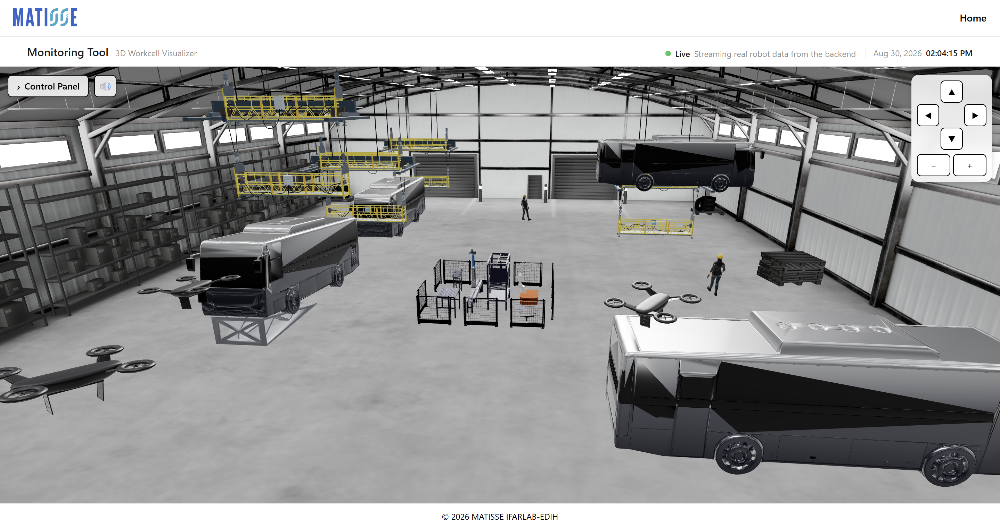

# MATISSE IFARLAB-EDIH Monitoring Tool


### v2 — factory-enabled workcell view



A browser-based **3D digital twin** for a two-robot workcell (a Universal Robots **UR10e** and a Kawasaki **RS005L** mounted on an AGV). It renders both robots from their real CAD/URDF mesh geometry, drives them either from **live telemetry stored in MongoDB Atlas** or from **manual on-screen controls**, and reproduces the original Gazebo simulation environment (safety fencing, cabinet, table, conveyor, AGV floor rail) around them.

The project is a small monorepo with two independent Node projects:

| Folder | What it is |
|---|---|
| [`client/`](client) | React + Three.js single-page app — the 3D viewer and control UI |
| [`api/`](api) | Express backend that streams the latest robot joint state from MongoDB to the client over Server-Sent Events |

---

## Features

- **Two fully-articulated robots**, built joint-by-joint from their actual STL meshes (not primitives):
  - **UR10e** — 6 rotational joints + a 7th linear rail axis (`UR10eMount`), plus a mounted 2-finger gripper.
  - **Kawasaki RS005L** — 6 rotational joints, mounted on an **OTA AGV mobile base** (`AGVBase`) that itself rides a 7th linear floor-rail axis, plus its SCHUNK EGP-50 gripper.
- **Live mode** — an `EventSource` connection streams real joint angles from MongoDB Atlas every ~250 ms; a **Live / Connecting / Offline** indicator in the header shows the connection state at a glance.
- **Manual mode** — every joint (6 per robot), each robot's 7th rail axis, and the gripper opening can be dragged by hand in the control panel; live updates are simply skipped while "Play demo animation" is on, so manual and live control never fight each other outside of that.
- **Demo animation** — a scripted, collision-aware "scan" motion for both arms plus rail sliding, driven by direct Three.js ref mutation (not React state) so it stays smooth at 60 fps.
- **Gazebo-accurate environment** — the floor fencing, cabinet, table, conveyor, chassis and AGV rail are the actual meshes from the original Gazebo world (`ifarlab.sdf`), positioned using the world's real coordinate frame and the robots' real spawn poses from the ROS 2 launch files, not guesswork.
- **Manual camera controls** — an on-screen rotate/zoom button cluster (top-right of the viewport) that does the same thing as left-click-drag (orbit) and scroll (zoom), for anyone who doesn't want to use the mouse gestures.
- **Otokar MATISSE body-control cell** — added next to the IFARLAB workcell, inside the same factory building (a 2.5 m aisle apart, both fitting one camera view): two 5-axis portal/gantry robots sharing one 16 m runway and straddling a bus body, rendered from Otokar's own STEP models with the kinematic chain nested axis 1 → 2 → 3 → 4 → 5 → camera head. Axis limits (16 000 / 3 350 / 1 800 mm plus the two rotary axes) are transcribed from Otokar's trajectory deck and cross-checked against the CAD, not estimated; the bus body is positioned by the three measured clearances from the same source. **Otokar R1 / R2** tabs in the control panel drive the axes, and a **Show Otokar MATISSE cell** toggle unmounts the whole cell (rather than merely hiding it) since these are the heaviest meshes in the scene. A single **Show other buses and lifts** toggle keeps every other filler prop (parked/hanging buses, the yellow lift rigs) available but off by default, so only the two workcells show on load. Two mesh detail tiers are generated and swapped automatically by camera distance.
- **Otokar demo animation** — "Play demo animation" drives both gantries through a fixed inspection sequence (front wall → rear wall → underbody → roof, the order Otokar's own deck lists) using real trapezoidal velocity profiles built from each axis's actual accel/cruise-speed/decel figures, not an eased lerp. `createCoordinatedMove` (`otokarMotion.js`) synchronises all five axes to arrive together each leg the way a real multi-axis controller runs a programmed move: the axis that needs the longest at its own rates sets the leg's duration, and every other axis is re-solved to take exactly that long by capping its cruise speed, never its accel/decel. Covered by a standalone test suite (`node --test scripts/otokar/motion.test.mjs`) that doesn't need a browser.
- **Responsive** — the control panel becomes a slide-in drawer on mobile, the navbar collapses to just a logo + Home link, and the layout adapts down to phone widths.

## Tech stack

**Frontend** (`client/`)
- [React 18](https://react.dev/) (Create React App / `react-scripts`)
- [react-three-fiber](https://docs.pmnd.rs/react-three-fiber) — React renderer for [Three.js](https://threejs.org/)
- [`@react-three/drei`](https://github.com/pmndrs/drei) — `OrbitControls`, `Html` helpers
- Plain CSS, no UI framework

**Backend** (`api/`)
- Node.js + [Express](https://expressjs.com/)
- [`mongodb`](https://www.npmjs.com/package/mongodb) official driver — reads from MongoDB Atlas
- Server-Sent Events (native `res.write`, no socket library) for the live stream
- `cors`, `dotenv`

## How it works


Quick-glance text version of the same flow:

```
MongoDB Atlas (joint_states collection)
        │  polled every request-interval (min 250 ms)
        ▼
api/server.js  ──HTTP GET /api/telemetry/joint-states/stream (SSE)──▶  client (EventSource)
        │                                                                     │
        │ converts raw doc → { ur10e:[6 deg], ur10eRail, kawasaki:[6 deg], agvRail }
        │                                                                     ▼
        │                                                        React state in DigitalTwin.js
        │                                                                     │
        └── api/debug.js: same Mongo read, prints to console (no HTTP)        ▼
                                                                   Three.js scene re-renders
                                                                   robots at the new joint angles
```

Each MongoDB document stores `ur10e` and `kawasaki` as **7-element arrays, in radians**: index 0 is the linear/prismatic "7th axis" (the UR10e's rail carriage position, or the AGV's position along its own floor rail), and indices 1–6 are the six arm joints in URDF order. `api/server.js` drops nothing — it converts the 6 rotational values to degrees for the arm, and passes the 7th value straight through in metres — and streams the result as a `joint_states` SSE event. The client's `EventSource` listener applies it directly to React state, which flows down into the Three.js joint groups.

The PlantUML source behind the diagram above is [`docs/sequence-diagram.puml`](docs/sequence-diagram.puml) — edit it and re-render with any PlantUML renderer (e.g. the PlantUML VS Code extension, or [plantuml.com](https://www.plantuml.com/plantuml)) if the flow changes.

### 3D asset sourcing

The STL meshes under `client/public/meshes/` come directly from the two robots' real ROS description packages (`Universal_Robots_ROS2_Description` for the UR10e, and the project's own `mobile_manipulator_description` for the Kawasaki + AGV + facility). Joint offsets and axes were taken from the packages' `.xacro` files, not eyeballed — see the comments at the top of `UR10eRobot.js` and `KawasakiRobot.js` for the exact joint table. The facility/environment layout in `EnvironmentElements.js` reconstructs the original `ifarlab.sdf` Gazebo world: every static prop's raw STL coordinates already encode its true position in that world's shared frame, and the robots' spawn poses were taken from `whole_ifarlab_gazebo.launch.py`, so the whole scene lines up without hand-placed guesswork. A few small furniture pieces (chassis, table, conveyor) have no matching xacro/launch entry in the source repo, so their placement is a best-effort reading of their own raw coordinates rather than a verified one — see the comments in `EnvironmentElements.js` for exactly which pieces that applies to.

### Otokar MATISSE cell asset sourcing

> **Confidential vendor data.** The source CAD for this cell is Otokar's
> commercial engineering data for the MATISSE project. The `.stp` files and the
> two source presentations are **not committed** — they live in `raw-cad/`,
> which is git-ignored. Only the derived, decimated display meshes under
> `client/public/meshes/otokar/` are in the repository. Before sharing either
> the raw CAD or the derived meshes outside this project, clear it with Otokar:
> the GLBs are decimated but they are still recognisable geometry of an
> unreleased vehicle body and a production inspection cell.

The cell is built from 13 STEP files (~360 MB): five axis assemblies plus a
camera head per robot, and the bus body. Browsers have no STEP loader and those
sizes are nowhere near web-shippable, so they are converted offline by
[`scripts/otokar/build_otokar_meshes.sh`](scripts/otokar/build_otokar_meshes.sh):

```
STEP ──FreeCAD Import──> filter ──tessellate──> GLB ──gltf-transform──> GLB
                            │                          weld
                            ├─ drop datum planes/axes   simplify (meshoptimizer)
                            ├─ drop fasteners by name   draco
                            ├─ drop parts below the LOD size floor
                            └─ crop to the installed assembly copy
```

Requires **FreeCAD 1.1+** (`freecadcmd` on `PATH` or `FREECADCMD` set) and
`npx`. Run it after populating `raw-cad/otokar/`:

```bash
bash scripts/otokar/build_otokar_meshes.sh                 # everything
bash scripts/otokar/build_otokar_meshes.sh Robot1_EKSEN3   # one part
```

Two LOD tiers are produced per part (`hi/` and `lo/`). The whole cell is about
**10.5 MB at high detail and 2.2 MB at low**, and the scene uses whichever tier
suits the camera distance.

Only Robot 1's axis files are converted. The two robots are the same machine —
identical face counts — and physically two carriages on one runway, so both
render from that one set and differ only in their axis-1 value. Robot 2's
exports are also the ones whose mirrored-duplicate crop does not resolve; see
[`docs/otokar-cad-notes.md`](docs/otokar-cad-notes.md).

After changing any placement constant, re-run the fit check, which replays the
scene's transform chain over the converted meshes and reports the margins to
the building's walls and roof:

```bash
node scripts/otokar/verify_cell_fit.mjs
```

As with the ROS-sourced meshes, the numbers in the code come from source data
rather than eyeballing, and where they could not be verified that is said out
loud. Axis 1's 16 000 mm travel is confirmed exactly against the STEP geometry,
and axes 4 and 5 are confirmed rotary by their NABTESCO reducers; the axis-2 /
axis-3 mapping is inferred from presentation slide order and is flagged as such
in `otokarAxes.js`, in `OtokarGantryRobot.js`, and with a `?` marker on the
affected sliders in the UI. The full cross-check, including the discrepancy
between the deck's Z/Y/X axis letters and the CAD frame, is in
[`docs/otokar-cad-notes.md`](docs/otokar-cad-notes.md).

Draco decoding uses a **self-hosted** decoder in `client/public/draco/` (copied
from the `three` package) rather than the gstatic CDN, so the viewer keeps
working on a shop floor without reliable outbound internet.

### Licensing for purchased 3D assets (STL / GLB)

This repo includes paid 3D assets purchased from marketplace platforms (for example, Fab). Those files are used under the applicable product license for each purchased model, and the license terms must be checked before redistribution, public hosting, or reuse outside the project scope.

For the purchased models currently used in this project, the relevant license is the product's **Fab Standard License** as published on the marketplace listing and linked in the vendor's terms page: https://www.fab.com/eula

Notes:

- `*.stl`, `*.glb`, `*.gltf`, and similar mesh files are not automatically covered by an open-source license unless the source marketplace explicitly says so.
- Commercial use, redistribution, and publication must remain consistent with the specific asset license attached to the purchased listing.
- If a model is used in a public demo, client delivery, or publication, keep the original purchase record and the listing URL in the project documentation.
- This repo does not redistribute the raw purchased asset pack as a separate public download unless the marketplace license explicitly allows it.
- This is a project-level compliance note and not legal advice; for final legal clearance, confirm the exact license terms for each asset in the store listing and purchase receipt.

Recommended practice for this project:

- keep a record of each marketplace listing URL and purchase receipt;
- store asset provenance in the same folder or documentation as the model files;
- do not re-upload vendor meshes to a public file-sharing site unless the license explicitly permits it;
- ensure any customer-facing deployment uses only the set of assets covered by the purchased license.

## Project structure

```
monitoring-tool/
├── api/                          Express + SSE backend
│   ├── server.js                 npm start — the HTTP/SSE server the client talks to
│   ├── debug.js                  npm run debug — one-off/console CLI dump of the latest Mongo doc
│   └── .env                      MONGODB_URI, DB_NAME, COLLECTION_NAME, PORT (not committed)
│
├── docs/
│   ├── sequence-diagram.puml     PlantUML source for the architecture diagram
│   └── otokar-cad-notes.md       Otokar STEP provenance + the axis-table cross-check
│
├── raw-cad/                      Vendor CAD — GIT-IGNORED, see licensing note above
│   └── otokar/                   Otokar's .stp files + the two source presentations
│
├── scripts/otokar/               Offline STEP → GLB conversion + placement checks
│   ├── build_otokar_meshes.sh    Driver: tessellate, decimate, Draco-compress (needs FreeCAD 1.1+)
│   ├── convert.py                FreeCAD-side import/filter/tessellate
│   ├── glbwrite.py               Minimal indexed-POSITION GLB writer
│   ├── probe.py / layout.py      Analysis helpers used for the CAD cross-check
│   ├── query_part.py             Reads a named part's datum faces out of a STEP
│   ├── audit_cad.py              Full per-axis part inventory (completeness audits)
│   ├── glb_bbox.mjs              World-space bbox of a GLB, no renderer needed
│   ├── roof_height.mjs           Real roof/truss clearance at a given x/z band
│   ├── scene_inspection.mjs      Runs the actual JSX scene graph offline (Babel + a
│   │                             minimal React/R3F shim), no browser or WebGL needed
│   ├── measure_ifarlab.mjs       IFARLAB cell's world-space bbox via scene_inspection
│   ├── verify_cell_fit.mjs       Checks the placed cell fits inside the building
│   └── motion.test.mjs           `node --test scripts/otokar/motion.test.mjs`
│                                 and coordinated-move unit tests, no browser needed
│
└── client/                       React app
    ├── public/
    │   ├── assets/logo/          MATISSE logo
    │   ├── draco/                Self-hosted Draco decoder (no CDN dependency)
    │   └── meshes/               Meshes served to the browser
    │       ├── ur10e/            UR10e arm + rail carriage + gripper
    │       ├── rs005l/           Kawasaki RS005L arm + gripper
    │       ├── ota/              AGV (OTA) mobile base + wheels
    │       ├── environment/      Facility props (fencing, cabinet, ifarlab_ray rail)
    │       └── otokar/           Otokar cell GLBs, two LOD tiers each
    │           ├── robot1/{hi,lo}/  axis1…axis5
    │           ├── robot2/{hi,lo}/  axis1…axis5
    │           ├── shared/{hi,lo}/  camera head (both robots)
    │           └── bus/{hi,lo}/     bus body
    └── src/
        ├── App.js / App.css      App shell: Navbar + page + Footer
        ├── components/
        │   ├── Navbar.js / Footer.js
        │   ├── Scene.js          Lighting + procedural grid-texture floor
        │   ├── UR10eRobot.js      UR10e kinematic chain + gripper
        │   ├── UR10eMount.js      UR10e's 7th-axis rail carriage
        │   ├── KawasakiRobot.js  Kawasaki kinematic chain + gripper
        │   ├── AGVBase.js         OTA mobile base + wheels
        │   ├── RailAnimator.js    Drives rail sliding during demo mode (ref-based, no re-render)
        │   ├── EnvironmentElements.js  Static workcell/facility meshes
        │   ├── ControlPanel.js / .css  Sidebar UI (both cells: joints, gantry axes, toggles)
        │   ├── otokarAxes.js      Otokar axis table + verification status (single source of truth)
        │   ├── OtokarMesh.js      Draco GLB loader for the Otokar meshes
        │   ├── OtokarCell.js      The whole Otokar cell as one placeable group
        │   ├── OtokarGantryRobot.js    One gantry robot, parametric on robotId
        │   └── OtokarBusBody.js        Bus body, placed by the three measured clearances
        └── pages/
            └── DigitalTwin.js / .css   Main page: layout, SSE client, camera, cell placement
```

## Getting started

### Prerequisites
- Node.js 18+ (developed on Node 24)
- A MongoDB Atlas cluster with a `joint_states` collection (see [Data model](#data-model) below)

### 1. Backend

```bash
cd api
npm install
cp .env.example .env   # if you don't already have one — see Environment variables below
npm start               # starts the SSE server on http://localhost:3001
```

You should see:
```
API listening: http://localhost:3001
MongoDB Atlas connection successful.
```

To just sanity-check the Mongo connection without the web server, use the CLI tool instead:
```bash
npm run debug        # polls and prints the latest document, Ctrl+C to stop
npm run debug:once   # prints once and exits
```

### 2. Frontend

```bash
cd client
npm install
npm start   # dev server, defaults to http://localhost:3000
```

Open the printed URL in a browser. The app talks to the backend at `http://localhost:3001/api` by default (see `REACT_APP_API_URL` below to point it elsewhere).

For a production build: `npm run build` (outputs to `client/build/`, serve with any static file server).

## Environment variables

**`api/.env`**

| Variable | Required | Default | Purpose |
|---|---|---|---|
| `MONGODB_URI` | yes | — | Atlas connection string |
| `DB_NAME` | no | `ifarlabmatisse_db_user` | Database name |
| `COLLECTION_NAME` | no | `joint_states` | Collection name |
| `PORT` | no | `3001` | Port the SSE server listens on (Render sets this automatically) |
| `CORS_ORIGIN` | no | *(allow all)* | Comma-separated list of allowed frontend origins in production, e.g. `https://your-app.vercel.app`. Leave unset for local dev. |
| `POLL_INTERVAL_MS` | no | `1000` | `debug.js` only — how often it re-polls Mongo (min 250) |

**`client/.env`** (optional)

| Variable | Default | Purpose |
|---|---|---|
| `REACT_APP_API_URL` | `http://localhost:3001/api` | Base URL the client's `EventSource` connects to |

## Data model

Each document in the `joint_states` collection looks like:

```jsonc
{
  "_id": "latest",           // server.js/debug.js always read this one first
  "ts": "2026-08-03T11:02:48.652Z",
  "ur10e":    [/* 7 numbers, radians: [rail_axis, shoulder_pan, shoulder_lift, elbow, wrist_1, wrist_2, wrist_3] */],
  "kawasaki": [/* 7 numbers, radians: [agv_rail_axis, joint1, joint2, joint3, joint4, joint5, joint6] */]
}
```

If no document has `_id: "latest"`, both `server.js` and `debug.js` fall back to the most recent document by `ts`.

### Otokar cell telemetry — proposed, not implemented

The Otokar gantries are **manual/demo only**: they are driven from the control
panel, and nothing in `api/` or the Mongo schema was changed for them. If they
are ever wired to live data, the shape that fits the existing pipeline is two
more top-level arrays alongside `ur10e` and `kawasaki`:

```jsonc
{
  "otokarRobot1": [/* 5 numbers: [axis1_mm, axis2_mm, axis3_mm, axis4_rad, axis5_rad] */],
  "otokarRobot2": [/* same */]
}
```

Two differences from the existing arrays are worth calling out before anyone
implements this:

- **Mixed units.** Indices 0–2 are linear axes; sending them in millimetres
  matches `otokarAxes.js` and the machine's own controller, and avoids a
  metres/millimetres conversion on the client. Indices 3–4 are rotary and
  would follow the existing convention: radians in Mongo, converted to degrees
  in `server.js`.
- **Length 5, not 7.** `DigitalTwin.js`'s `joint_states` listener validates the
  existing fields with `length === 6` checks, so it needs its own guard for
  these rather than reusing that one.

This would also mean swapping the cell's props from panel state to stream
state in `DigitalTwin.js`, the same way `jointAngles`/`kawasakiAngles` already
work — including the "demo animation wins over live data" rule.

## Using the app

- **Navbar** — MATISSE logo (left) and Home (right); minimal by design.
- **Live badge** (top-right of the secondary header) — green/blinking "Live" once real telemetry is flowing, gray "Connecting" while the SSE connection is establishing, red "Offline" if the backend can't be reached.
- **Robot tabs** (top of the sidebar) — switch the control panel between UR10e and Kawasaki; each robot keeps its own joint/rail state independently.
- **Joints** — one slider per rotational joint (±360°) plus a "Rail (7th axis)" slider in metres for that robot's linear axis. Sliders are disabled while demo animation is playing, and are overwritten by live data unless animation is on.
- **Animation** — "Play demo animation" runs a safe, repeatable scan/inspect motion (ignores live/manual joint values while active); "Speed" scales how fast it runs.
- **Gripper** — one slider (0–100% opening) shared by both robots' grippers.
- **Show environment** — toggles the facility props (fencing, cabinet, table, conveyor, chassis, AGV rail) on/off, leaving just the two robots and the floor.
- **3D viewport** — left-click drag to orbit, right-click drag to pan, scroll to zoom, or use the ▲◀▶▼ / +/− button cluster in the top-right corner for the same gestures without a mouse.

## Known limitations

- A handful of environment meshes (`chassis.stl`, `alumuniumtable.stl`, `conveyorbelt.stl`) have no corresponding entry in any `.xacro` or launch file in the source repo, so their on-screen position is a best-effort reading of their own raw coordinates rather than a verified placement — see the comment block at the top of `EnvironmentElements.js`.
- The backend has no authentication — it's meant to run behind a trusted network/VPN or be fronted by your own auth layer before exposing it publicly.
- `api/.env` is git-ignored on purpose; you must supply your own Atlas credentials to run the backend.
